<!-- ui-diff:sticky id=default -->
### UI diff — 5 measured changes on 1 route

**Base** `6737326` → **Head** `cc13cab` · 1 route · desktop, mobile · light, dark

4 captures · 4 changed · 0 unchanged

#### Measured changes

**`/`**

- `label 'Work email'` (`label`): color #0f172a → #2563eb — desktop, mobile · light
- `label 'Work email'` (`label`): color #f8fafc → #2563eb — desktop, mobile · dark
- `link 'Start free trial'` (`a.cta`): padding 8px 14px → 10px 18px — desktop, mobile · light, dark
  - size 134.5×40px → 142.5×44px (from the padding change)
  

10 effects on other elements

  - `div.hero-actions`: size on desktop · light, dark: 992×40px → 992×44px; size on mobile · light, dark: 342×40px → 342×44px
  - `main.container`: size on desktop · light, dark: 1040×1452px → 1040×1456px; size on mobile · light, dark: 390×1747.5px → 390×1751.5px
  - `section.hero`: size on desktop · light, dark: 992×679px → 992×683px; size on mobile · light, dark: 342×488.5px → 342×492.5px
  - `div.hero-copy`: size on desktop · light, dark: 992×195px → 992×199px; size on mobile · light, dark: 342×221px → 342×225px
  - `link 'See how it works'` (`a.secondary`): moved 9px right, 2px down
  - `img.hero-art`: moved 4px down
  - `#features`: moved 4px down
  - `#pricing`: moved 4px down
  - `section.newsletter`: moved 4px down
  - `footer.site-footer`: moved 4px down

  

- `link 'Start free trial'` (`a.cta`): border-radius 4px → 8px — desktop, mobile · light, dark
- `div.hero-actions`: gap 16px → 17px — desktop, mobile · light, dark

#### Images

**`/`** · desktop · light — 0.34% of pixels changed · 2 areas · content shifted down 4px (unchanged, not counted) · page height 1603 → 1607px

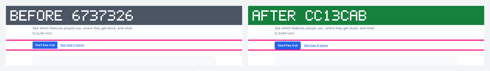

link 'Start free trial': padding 8px 14px → 10px 18px · border-radius 4px → 8px

Blink and diff

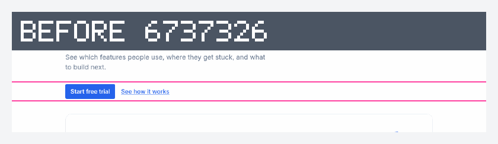

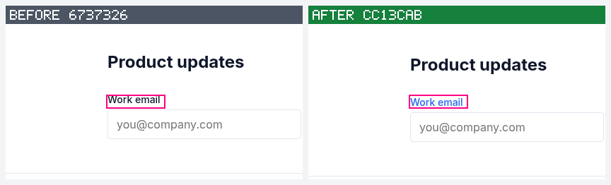

label 'Work email': color #0f172a → #2563eb

Blink and diff

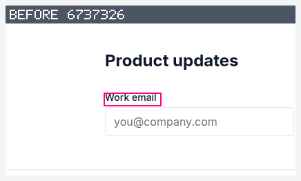

Full page

**`/`** · desktop · dark — 0.34% of pixels changed · 2 areas · content shifted down 4px (unchanged, not counted) · page height 1603 → 1607px

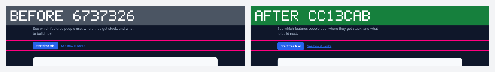

link 'Start free trial': padding 8px 14px → 10px 18px · border-radius 4px → 8px

Blink and diff

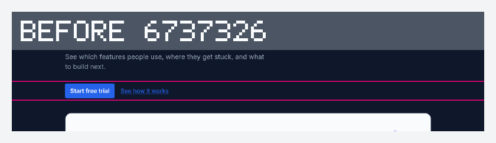

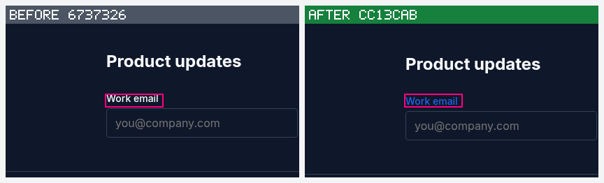

label 'Work email': color #f8fafc → #2563eb

Blink and diff

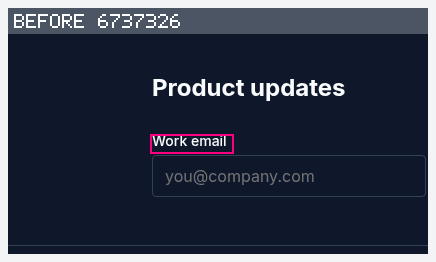

Full page

**`/`** · mobile · light — 0.40% of pixels changed · 2 areas · content shifted down 4px (unchanged, not counted) · page height 1936 → 1940px

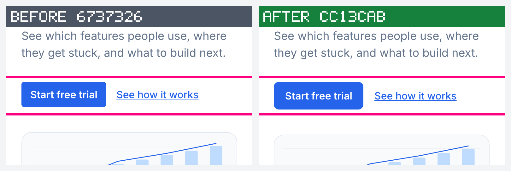

link 'Start free trial': padding 8px 14px → 10px 18px · border-radius 4px → 8px

Blink and diff

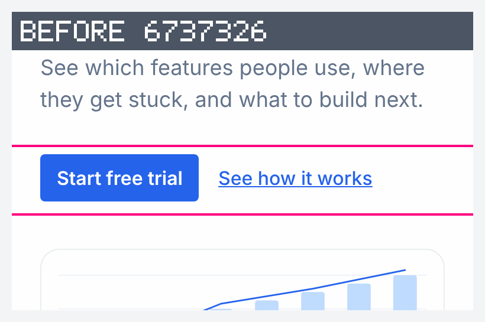

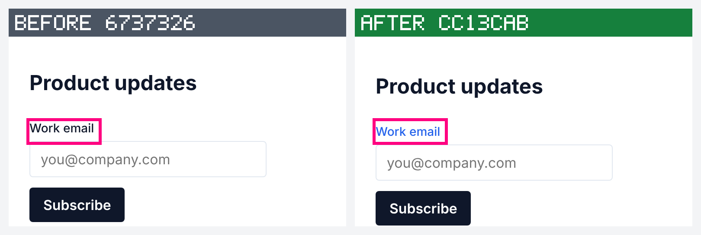

label 'Work email': color #0f172a → #2563eb

Blink and diff

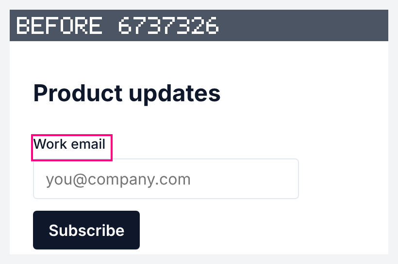

Full page

**`/`** · mobile · dark — 0.40% of pixels changed · 2 areas · content shifted down 4px (unchanged, not counted) · page height 1936 → 1940px

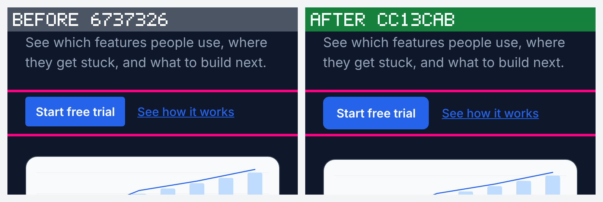

link 'Start free trial': padding 8px 14px → 10px 18px · border-radius 4px → 8px

Blink and diff

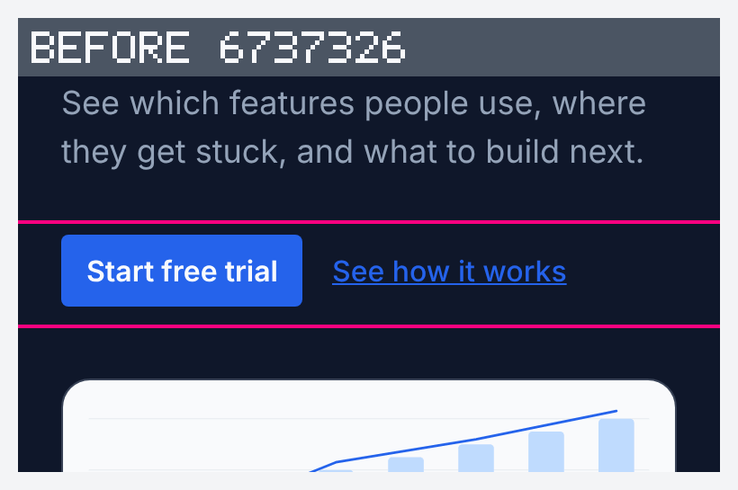

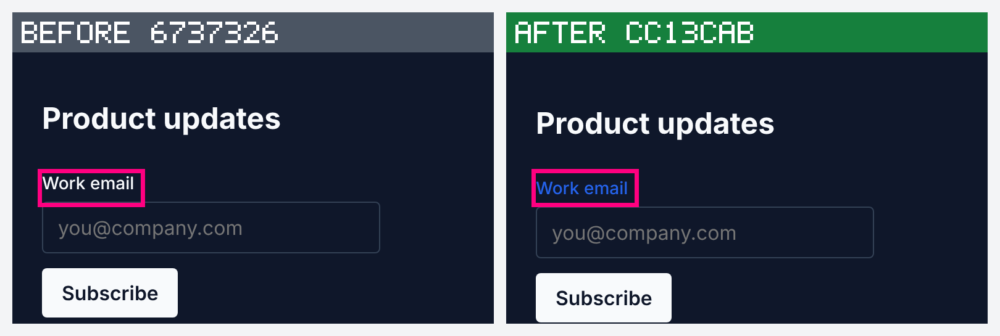

label 'Work email': color #f8fafc → #2563eb

Blink and diff

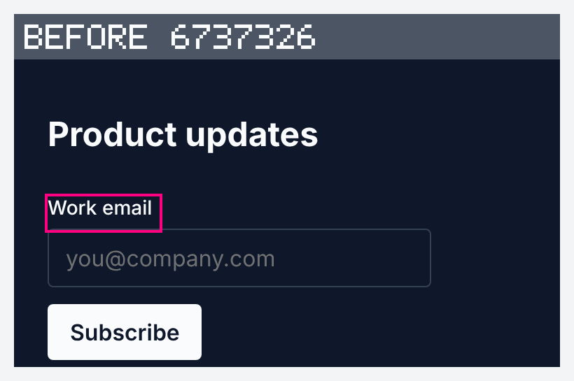

Full page

#### Variants

**`/` · desktop · light** — compare `?hero=` and pick one

<table><tr>
<th>hero=1</th>
<th>hero=2</th>
<th>hero=3</th>
<th>hero=4</th>
</tr><tr>
<td valign="top"></td>
<td valign="top"></td>
<td valign="top"></td>
<td valign="top"></td>
</tr></table>

- [ ] `hero=1` <!-- ui-diff-pick:home:desktop:hero=1 -->
- [ ] `hero=2` <!-- ui-diff-pick:home:desktop:hero=2 -->
- [ ] `hero=3` <!-- ui-diff-pick:home:desktop:hero=3 -->
- [ ] `hero=4` <!-- ui-diff-pick:home:desktop:hero=4 -->

#### Motion

**`/`** · desktop — wait 400ms, hover .cta, wait 700ms, click [data-tab=yearly] (not on base), wait 900ms

> ⚠️ no motion detected: the clip has a single frame on both sides (nothing animated during these steps)

[before.webm](motion/home__desktop__light__before.webm) · [after.webm](motion/home__desktop__light__after.webm)

#### Accessibility — 1 new, 0 fixed

| | Issue | Impact | Element | Where |
|---|---|---|---|---|
| New | [Elements must meet minimum color contrast ratio thresholds](https://dequeuniversity.com/rules/axe/4.14/color-contrast?application=axeAPI) `color-contrast` _(contrast)_ | serious | `label` | `/` desktop/dark, mobile/dark |

#### Design tokens — 3 new off-token values

| Property | Value | Nearest token | Elements |
|---|---|---|---|
| spacing | `17px` | `space.4 (16px)` | `div.hero-actions` |
| spacing | `10px` | `space.2 (8px)` | `a.cta` |
| spacing | `18px` | `space.4 (16px)` | `a.cta` |

Audited the changed areas of 4 captures.

Changed UI files that match no route (not captured): 34

- `docs/example/compare/home__desktop__dark.png`
- `docs/example/compare/home__desktop__light.png`
- `docs/example/compare/home__desktop__light__focus-1.png`
- `docs/example/compare/home__desktop__light__focus-2.png`
- `docs/example/compare/home__mobile__dark.png`
- `docs/example/compare/home__mobile__light.png`
- `docs/example/motion/home__desktop__light.gif`
- `docs/example/variants/home__desktop__light__hero-1.png`
- `docs/example/variants/home__desktop__light__hero-2.png`
- `docs/example/variants/home__desktop__light__hero-3.png`
- `docs/example/variants/home__desktop__light__hero-4.png`
- `docs/example/variants/home__desktop__light__hero__strip.png`
- `skills/ui-diff/schema/ui-diff.config.schema.json`
- `skills/ui-diff/src/align.ts`
- `skills/ui-diff/src/capture.ts`
- `skills/ui-diff/src/cli.ts`
- `skills/ui-diff/src/config.ts`
- `skills/ui-diff/src/conventions.ts`
- `skills/ui-diff/src/detect.ts`
- `skills/ui-diff/src/diff.ts`
- `skills/ui-diff/src/github.ts`
- `skills/ui-diff/src/imports.ts`
- `skills/ui-diff/src/log.ts`
- `skills/ui-diff/src/markdown.ts`
- `skills/ui-diff/src/motion.ts`
- `skills/ui-diff/src/paths.ts`
- `skills/ui-diff/src/pipeline.ts`
- `skills/ui-diff/src/publish.ts`
- `skills/ui-diff/src/report.ts`
- `skills/ui-diff/src/server.ts`
- `skills/ui-diff/src/sides.ts`
- `skills/ui-diff/src/stylex.ts`
- `skills/ui-diff/src/tokens.ts`
- `skills/ui-diff/src/unsettled.ts`

Capture settings and timing · ⏱ 29s

| | Base | Head |
|---|---|---|
| Commit | `6737326` | `cc13cab` |
| Viewports | desktop 1280×800 @1x · mobile 390×844 @2x mobile | same |
| Browser | chromium 159.0.8154.6 | same |
| Web fonts | none | same |
| Frozen | clock 2026-01-15 09:30:00 UTC · seed 795556381 · animations off · fonts awaited | same |
| Media | reduced motion · light/dark · en-US · UTC | same |
| Test data | not declared | same |
| Base cache | captured now (`base-6737326b2e05-19cef14daae165b3`) | — |

User agent: desktop `Mozilla/5.0 (X11; Linux x86_64) AppleWebKit/537.36 (KHTML, like Gecko) HeadlessChrome/159.0.8154.6 Safari/537.36`; mobile `Mozilla/5.0 (iPhone; CPU iPhone OS 17_0 like Mac OS X) AppleWebKit/605.1.15 (KHTML, like Gecko) Version/17.0 Mobile/15E148 Safari/604.1`

**Timing**

⏱ 29s total · detect 0.0s · prepare 0.5s (base: none 0.0s, boot 0.4s ‖ head: none 0.0s, boot 0.4s) · browser 0.0s · capture 14s (8 screenshots, slowest 1.8s) · diff 4.2s · variants 6.4s · motion 4.5s · a11y 1.1s · tokens 0.0s · element map 0.3s · style diff 0.0s

| Phase | Time | |
|---|---|---|
| detect | 0.0s | changed files → routes |
| base | 0.4s | checkout 0.0s · install 0.0s (none) · boot 0.4s |
| head | 0.5s | checkout 0.0s · install 0.0s (none) · boot 0.4s |
| prepare | 0.5s | base and head at the same time (wall clock) |
| browser | 0.0s | Chromium check and launch |
| capture | 14s | 8 screenshots · slowest `home__mobile__light` (base) 1.8s |
| diff | 4.2s | pixel diffs and composites |
| variants | 6.4s | variant screenshots |
| motion | 4.5s | motion clips |
| a11y | 1.1s | axe and focus order (during capture) and the delta |
| tokens | 0.0s | the token audit |
| element map | 0.3s | element maps of every capture (taken during capture) |
| style diff | 0.0s | matching elements, measuring style changes, naming changed areas |
| total | 29s | wall clock until the report was written |

ui-diff 2.0.0 · base `6737326` · head `cc13cab` · full report: [report.json](report.json) · rendered locally — nothing uploaded · generated 2026-11-21 21:06:40 UTC
<!-- ui-diff:meta {"head":"cc13cab81ca4c056ebe8ed861cce6747f2495e59","base":"6737326b2e051665eb7b14a33d39acee32ff22de","createdAt":"2026-11-21T21:06:40.518Z"} -->
